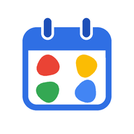
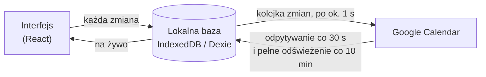

<div align="center">



# Pulsecal

**Kalendarz w stylu Google Calendar jako aplikacja webowa (PWA): szybszy, z miękkimi, sprężystymi animacjami.**
Dane są najpierw na urządzeniu, a Google Calendar służy jako kopia zapasowa.


</div>

---

## Co to jest

Pulsecal to osobisty kalendarz, który wygląda i działa jak Google Calendar, ale:

- **jest szybszy i przyjemniejszy** — miękkie, „bąblowe” kształty, sprężyste animacje z lekkim przestrzeleniem
  przy otwieraniu i upuszczaniu (z ustawieniem tempa albo bez animacji);
- **trzyma dane u Ciebie** — wpisy są w lokalnej bazie przeglądarki (IndexedDB), więc kalendarz działa od razu
  i bez internetu, a zmiany same wysyłają się do Google Calendar;
- **ma mało tarcia** — wpis dodasz jednym zdaniem, a dzień uporządkujesz kilkoma kliknięciami.

Na iPhonie instaluje się go z Safari („Udostępnij → Do ekranu początkowego”) i działa jak zwykła aplikacja.

## Najważniejsze funkcje

- 🗺️ **Trzy widoki:** „mapa” (21 dni obok siebie, doba w pionie), „miesiąc” (układ jak w Google Calendar)
  i „zadania” (prosta Jira do spraw osobistych: epiki, zadania, lista i tablica).
- ✍️ **Dodawanie jednym zdaniem:** `dentysta jutro 14:30 1h #wizyta` → wpis z datą, godziną, długością i tagiem.
- 🧲 **Przeciąganie i rozciąganie** wpisów myszą albo palcem (przytrzymanie), z „Cofnij” po każdej zmianie.
- 📋 **Przegląd dnia:** wszystkie wpisy dnia w jednym oknie; „>” na jutro, „>>” za tydzień, „×” usuwa.
  Grupy („na szybko”, wybrane tagi i epiki), wpisy „low priority” przygaszone, ważne z czerwonym „!”.
- 🏷️ **Tagi** z regułami (np. tytuł zaczynający się od „!” dostaje tag „ważne”), kolorami i filtrem.
- ⏱️ **Estymata** (5 min / 30 min / 1 h / 2 h+) i przycisk **„P”**: wpis trafia w najbliższą wolną godzinę
  w Twoich godzinach produktywności.
- 🧩 **Zadania i epiki** z postępem, komentarzami i własnymi polami; zadanie można przeciągnąć na kalendarz.
- 🎉 **Zachęty i mini-osiągnięcia** po zamknięciu zadania albo usunięciu wpisu („On fire! 🔥 ×3”).
- 🌙 **Motyw jasny i ciemny**, działanie offline, automatyczne aktualizacje.

Pełny opis wszystkich funkcji jest w [FEATURES.md](FEATURES.md).

## Jak to działa



- **Źródłem prawdy jest lokalna baza.** Interfejs nigdy nie czeka na Google: zmiana zapisuje się na urządzeniu,
  a do Google wysyła się w tle. Bez internetu kolejka czeka na jego powrót.
- **Google Calendar to kopia zapasowa.** Wpisy są zwykłymi wydarzeniami w wybranym kalendarzu. Zadania, epiki
  i ustawienia aplikacji też mają kopię w Google, jako ukryte wpisy z 2 stycznia 2000.
- **Bez własnego serwera.** Logowanie odbywa się w przeglądarce (Google Identity Services), a dane idą tylko
  między przeglądarką a Twoim kontem Google.

## Uruchomienie

Wymagania: [Node.js](https://nodejs.org/) 20.19+ albo 22.12+ i npm.

```bash
git clone https://github.com/tomaszrybicki/pulsecal.git
cd pulsecal
npm install
npm run dev
```

Aplikacja otworzy się pod adresem `http://localhost:5173`.

| Polecenie | Co robi |
| --- | --- |
| `npm run dev` | serwer deweloperski (dostępny też w sieci lokalnej: `http://<ip-komputera>:5173`) |
| `npm run build` | sprawdzenie typów (TypeScript) i wersja produkcyjna w `dist/` |
| `npm run preview` | podgląd wersji produkcyjnej |

## Połączenie z Google Calendar (opcjonalne)

Bez Google Pulsecal działa w pełni lokalnie. Żeby mieć kopię w Google Calendar, potrzebny jest własny
**OAuth Client ID** (bezpłatny):

1. Wejdź do [Google Cloud Console](https://console.cloud.google.com/) i utwórz projekt.
2. W „APIs & Services → Library” włącz **Google Calendar API**.
3. Skonfiguruj ekran zgody OAuth: typ **External**, a w „Test users” dodaj swoje konto Google.
4. W „Credentials” utwórz **OAuth client ID** typu **Web application**. W „Authorized JavaScript origins”
   dodaj `http://localhost:5173` oraz adres HTTPS, pod którym aplikacja będzie działać. Adresy przekierowania
   (redirect URI) nie są potrzebne.
5. W Pulsecal kliknij kropkę w prawym górnym rogu, wklej **OAuth Client ID**, kliknij „Połącz” i wybierz kalendarz.

Client ID możesz też wpisać do pliku `.env.local` jako `VITE_GOOGLE_CLIENT_ID=…` (wzór w
[.env.example](.env.example); ten plik nie trafia do repozytorium).

Aplikacja prosi o dwa uprawnienia: `calendar.events` (wpisy) i `calendar.calendarlist.readonly` (lista kalendarzy).

## Na iPhonie

1. Umieść aplikację pod adresem **HTTPS** (np. GitHub Pages, Netlify, Cloudflare Pages) i dodaj ten adres
   w „Authorized JavaScript origins” w Google Cloud.
2. Otwórz go w Safari → „Udostępnij” → **„Do ekranu początkowego”**.

Przez zwykłe `http://` w sieci lokalnej aplikacja się otworzy, ale bez logowania do Google i bez trybu offline
(oba wymagają HTTPS).

## Prywatność i dane

- Wpisy, zadania i ustawienia są w przeglądarce (IndexedDB i localStorage) na Twoim urządzeniu.
- Po połączeniu z Google kopia trafia wyłącznie do Twojego kalendarza Google. Nie ma żadnego serwera pośredniczącego.
- Token Google jest ważny ok. godziny i zostaje tylko w przeglądarce; nie trafia do kopii ustawień.

## Ograniczenia

- **Ponowne logowanie do Google mniej więcej co godzinę** (jedno kliknięcie w kropkę). Bez własnego serwera
  Google nie daje trwałego dostępu.
- **Brak synchronizacji w tle na iPhonie:** iOS nie pozwala aplikacjom webowym działać w tle, więc
  synchronizacja odbywa się, gdy aplikacja jest otwarta.
- **Konflikty:** gdy ten sam wpis zmieni się jednocześnie w Pulsecal i w Google, wygrywa nowsza zmiana.

Plany i lista TODO są w [HANDOFF.md](HANDOFF.md).

## Struktura projektu

```
src/
  App.tsx            stan aplikacji, widoki, edycja i przenoszenie wpisów
  db.ts              lokalna baza (Dexie / IndexedDB)
  sync/google.ts     logowanie Google i synchronizacja
  components/        widoki i okna: mapa, miesiąc, przegląd dnia, zadania, edycja, ustawienia…
  hooks/             synchronizacja, przeciąganie, zegar…
public/              ikony aplikacji (PWA)
```

## Dokumentacja

| Plik | Zawartość |
| --- | --- |
| [FEATURES.md](FEATURES.md) | pełny opis funkcji |
| [CHANGELOG.md](CHANGELOG.md) | historia wersji |
| [HANDOFF.md](HANDOFF.md) | stan prac i plany (po angielsku) |
| [CLAUDE.md](CLAUDE.md) | konwencje projektu dla Claude Code (po angielsku) |

Każda wersja to jeden commit `vX.Y.Z: …` i tag `vX.Y.Z`; opis zmian jest w [CHANGELOG.md](CHANGELOG.md).
Projekt nie ma testów automatycznych: wersja jest gotowa, gdy `npm run build` przechodzi bez błędów.

## Licencja

Brak licencji: wszystkie prawa zastrzeżone. Kod można przeglądać na GitHubie, ale bez zgody autora nie wolno
go kopiować, zmieniać ani rozpowszechniać.
